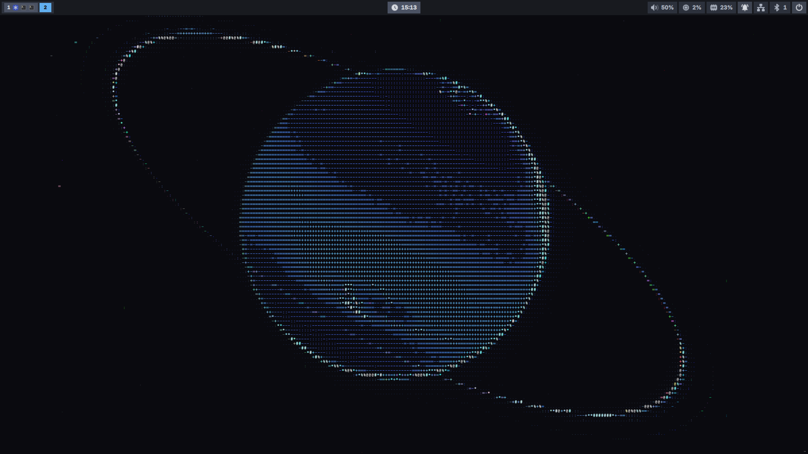
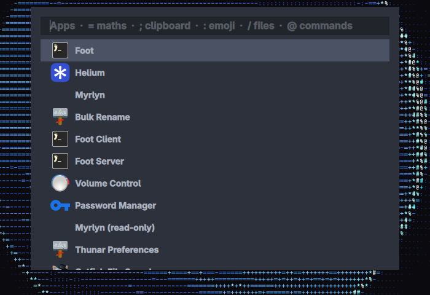
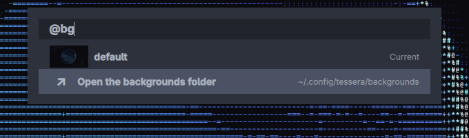
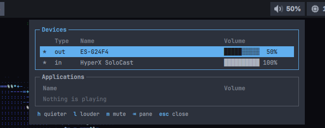
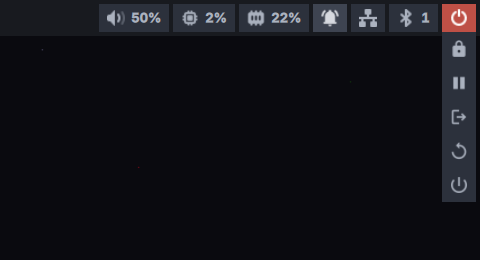
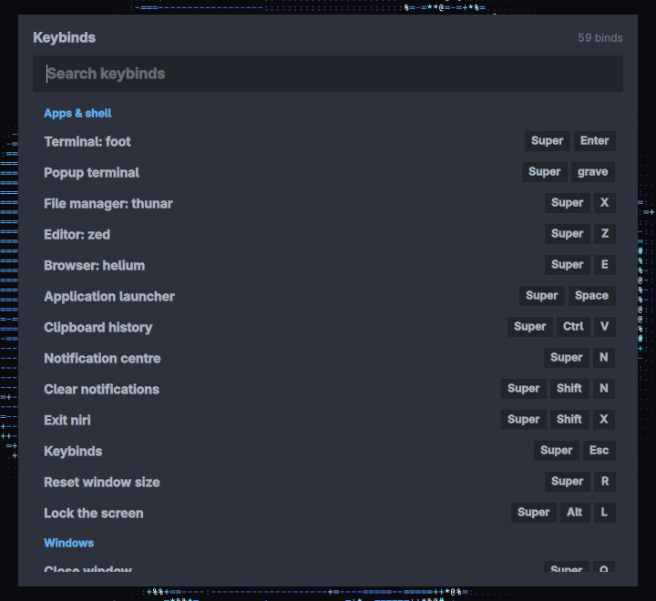
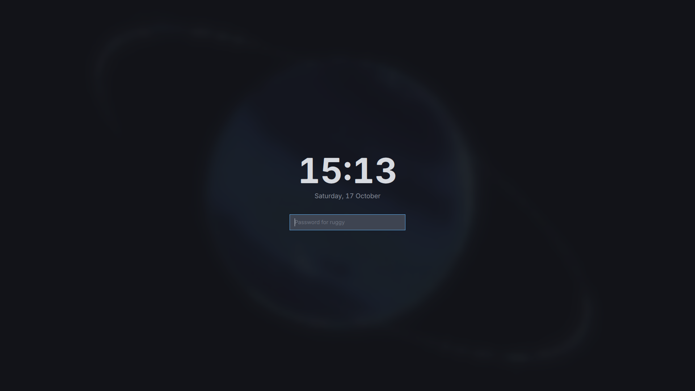

# Tessera

A desktop shell for the [niri](https://github.com/YaLTeR/niri) compositor,
built on [Quickshell](https://quickshell.org). Square tiles, One Dark colours,
terminal-styled panels and quiet, smooth motion.



## Features

- **Bar.** Workspaces with the apps open on each, the focused window's title,
  a clock with a calendar, world clocks and media controls, a system tray, and
  indicators for volume, CPU, memory, notifications, network, Bluetooth, the
  microphone and power. Everything has hover tooltips.
- **Launcher.** Fuzzy app search that learns which apps you use, with inline
  maths and web search, plus prefix modes:
  - `;` clipboard history (cliphist)
  - `:` emoji
  - `/` files in your home folder
  - `@` commands, such as `@bg` to pick a wallpaper, `@lock`, `@dnd` and
    `@terminal`
- **Panels in the style of [bluetui](https://github.com/pythops/bluetui) and
  impala** for network, Bluetooth and volume (per-app volume included). Drive
  them with the keyboard (`tab`, `j`/`k`, and the footer's keys) or the mouse.
- **Notifications.** Toasts that stack and follow each sender's timeout, a
  history panel, and do-not-disturb.
- **Lock screen.** Your wallpaper blurred, with a clock and a password field,
  checked through PAM. It locks automatically on idle via swayidle.
- **Popup terminal.** A fresh foot that floats over everything and closes as
  soon as it loses focus.
- **Wallpapers.** Drop images in a folder and pick one with `@bg`. Changes
  crossfade.
- **And:** a keybinds overlay read from your niri config, an icon-only power
  menu that asks twice before ending the session, volume and microphone OSDs,
  and consistent motion throughout, all scaled by one setting.

| Launcher | Wallpaper picker |
| --- | --- |
|  |  |

| Volume panel | Power menu |
| --- | --- |
|  |  |

| Keybinds | Lock screen |
| --- | --- |
|  |  |

## Requirements

Tessera is developed on openSUSE Tumbleweed with niri 26.04 and the
`noctalia-qs` build of Quickshell (0.0.12). Upstream Quickshell should work if
it includes the Networking, Bluetooth, PAM and session-lock modules.

| Needed for | Packages |
| --- | --- |
| The shell | Quickshell, niri, Qt 6 with Qt5Compat (GraphicalEffects) and `Qt.labs.folderlistmodel` |
| Audio | PipeWire (`wpctl` for media keys) |
| Network and Bluetooth | NetworkManager (`nmcli`), BlueZ |
| Clipboard history | `cliphist`, `wl-clipboard` |
| File search | `ripgrep` |
| Popup terminal | `foot` |
| Locking on idle | `swayidle`, and `swaylock`'s PAM file (see [Lock screen](#lock-screen)) |
| Opening files and links | `xdg-utils` |
| Fonts | Adwaita Sans, JetBrains Mono, Noto Color Emoji |

## Installation

Quickshell loads `~/.config/quickshell` by default:

```sh
git clone https://github.com/<you>/tessera ~/.config/quickshell
mkdir -p ~/.config/tessera/backgrounds   # wallpapers for @bg
```

Then add the pieces below to `~/.config/niri/config.kdl` and log in again.

### niri configuration

```kdl
spawn-at-startup "quickshell"

// Lock after 10 minutes idle (media playback holds it off), before suspend,
// and on `loginctl lock-session`.
spawn-at-startup "swayidle" "-w" "timeout" "600" "qs ipc call lock lock" "before-sleep" "qs ipc call lock lock; sleep 1" "lock" "qs ipc call lock lock"

// The popup terminal floats, centred.
window-rule {
    match app-id="^shell-popup$"
    open-floating true
    open-focused true
    default-column-width { proportion 0.5; }
    default-window-height { proportion 0.55; }
}

binds {
    Mod+Space  hotkey-overlay-title="Application launcher" { spawn "qs" "ipc" "call" "launcher" "toggle"; }
    Mod+Ctrl+V hotkey-overlay-title="Clipboard history"    { spawn "qs" "ipc" "call" "clipboard" "toggle"; }
    Mod+grave  hotkey-overlay-title="Popup terminal"       { spawn "qs" "ipc" "call" "terminal" "toggle"; }
    Mod+Escape hotkey-overlay-title="Keybinds"             { spawn "qs" "ipc" "call" "keybinds" "toggle"; }
    Mod+N      hotkey-overlay-title="Notification centre"  { spawn "qs" "ipc" "call" "notifications" "toggle"; }
    Mod+Alt+L  hotkey-overlay-title="Lock the screen"      { spawn "qs" "ipc" "call" "lock" "lock"; }

    XF86AudioRaiseVolume allow-when-locked=true { spawn-sh "wpctl set-volume -l 1 @DEFAULT_AUDIO_SINK@ 5%+"; }
    XF86AudioLowerVolume allow-when-locked=true { spawn-sh "wpctl set-volume @DEFAULT_AUDIO_SINK@ 5%-"; }
    XF86AudioMute        allow-when-locked=true { spawn-sh "wpctl set-mute @DEFAULT_AUDIO_SINK@ toggle"; }
    XF86AudioMicMute     allow-when-locked=true { spawn-sh "wpctl set-mute @DEFAULT_AUDIO_SOURCE@ toggle"; }
}
```

The volume and mic OSDs follow PipeWire, so they react to these keys (or to
anything else that changes the volume) without further setup.

## Usage

### Launcher

| Type | To |
| --- | --- |
| an app name | launch it (apps you use often rank first among equal matches) |
| `2^10`, `sqrt 2`, `1,000 * 3` | do maths; Enter copies the result |
| a URL or anything else | open it, or search the web |
| `;` | browse clipboard history; Enter copies, Shift+Delete forgets |
| `:fire` | find emoji by name; Enter copies |
| `/notes` | find files under `~`; Enter opens, Shift+Enter opens the folder |
| `@` | list commands; `@bg` picks a wallpaper |

`Ctrl+J`/`Ctrl+K` or the arrow keys move the selection, and `Esc` closes.

### Panels

Click the network, Bluetooth or volume icon in the bar (or use IPC). `Tab`
moves between panes, `j`/`k` between rows, and the footer lists the keys for
the focused pane. Each hint is also a button.

### IPC

Everything can be driven from niri binds or scripts:

```
qs ipc call launcher      toggle | open | close
qs ipc call clipboard     toggle | open                 # the launcher, in clipboard mode
qs ipc call keybinds      toggle | open | close
qs ipc call logout        toggle | open | close         # the power menu
qs ipc call lock          lock | preview | closePreview
qs ipc call terminal      toggle | open | close         # popup terminal
qs ipc call wallpaper     next | previous | random | set <path>
qs ipc call volume        toggle | open | close
qs ipc call network       toggle | open | close
qs ipc call bluetooth     toggle | open | close
qs ipc call notifications toggle | clear | toggleDnd | dndOn | dndOff
```

`qs ipc show` lists them all.

## Configuration

Settings live in [`ShellGlobals.qml`](ShellGlobals.qml):

| Setting | Default | What it does |
| --- | --- | --- |
| `fontFamily`, `monoFamily`, `fontSize` | Adwaita Sans, JetBrains Mono, 11 | UI and panel fonts |
| `materialColors` | One Dark | Every colour in the shell, by role |
| `radius` | `0` | Corner radius everywhere; square by default |
| `motionScale` | `1` | Multiplies every animation's duration; `0` turns motion off |
| `animFast` / `animNormal` / `animSlow` | 150 / 250 / 400 ms | Durations for hover, opening and long travel |
| `wallpaperDir` | `~/.config/tessera/backgrounds` | Folder `@bg` lists (PNG, JPEG, WebP) |
| `fileSearchSkip` | `["~/config"]` | Folders under `~` that `/` file search ignores |
| `searchEngineUrl`, `searchEngineName` | Google | Web search from the launcher (`%s` is the query) |
| `worldClocks` | Brasília | Extra clocks in the clock menu, as fixed UTC offsets |
| `lockPamConfig`, `lockPamDir` | `swaylock`, `/usr/lib/pam.d` | PAM service the lock screen authenticates with |

Saving any file hot-reloads the running shell. `qs log -t 40` shows warnings.

## Lock screen

The lock screen authenticates through the PAM service set by `lockPamConfig`
and `lockPamDir`. It defaults to swaylock's service, which most distributions
ship (openSUSE keeps it in `/usr/lib/pam.d`, others in `/etc/pam.d`). Check
the file exists before relying on the lock:

```sh
ls /etc/pam.d/swaylock /usr/lib/pam.d/swaylock
qs ipc call lock preview   # the lock screen in a normal window; try your password
```

**If it ever gets stuck:** should Quickshell crash while the session is locked,
niri keeps the screen locked (blank) until a lock client unlocks it. Switch to
a TTY (`Ctrl+Alt+F2`), log in, run `WAYLAND_DISPLAY=wayland-1 swaylock`,
switch back, and unlock with your password.

## Development

| Path | What lives there |
| --- | --- |
| `shell.qml` | Entry point |
| `ShellGlobals.qml` | Settings and theme |
| `services/` | Singletons that own data and talk to the system: `Niri`, `Audio`, `Media`, `Notifications`, `SystemStats`, `Internet`, `BluetoothState`, `Clipboard`, `Wallpapers` |
| `components/` | Reusable UI with no data of its own: `BarPopup`, `BarPanel`, `OverlayController`, `Reveal`, `Anim`/`CAnim`, `Tooltip`, `TintedIcon`, `Track`, and the terminal-styled `TuiPane`, `TuiTable`, `TuiFooter` |
| `bar/` | The bar (one per screen), its widgets, menus and panels |
| `launcher/` | The launcher and its modes. `Emoji.js` is generated by `gen-emoji.py` |
| `keybinds/` | The keybinds overlay and its niri config parser |
| `lock/`, `logout/`, `osd/`, `terminal/`, `wallpaper/` | Lock screen, power menu, OSDs, popup terminal, wallpaper |
| `tests/` | Headless unit tests for the JS logic |

Run the tests with `./tests/run.sh`. It needs only `qs`, prints PASS or FAIL
per case, and exits non-zero on failure.

### Extending

- **A bar widget:** a `BarWidget` in `bar/` with `icon`, `label`, `color`,
  `foreground`, and `interactive`/`tooltip` as needed, placed in a row of
  `bar/Bar.qml`. Keep polling and system access in a `services/` singleton, so
  a second monitor doesn't double the work.
- **A bar menu:** subclass `BarPopup` (or `BarPanel` if it needs the
  keyboard), set `contentHeight`, declare it in `bar/Bar.qml`, and add it to
  `popups` there. That list is what lets outside clicks dismiss it.
- **A launcher command:** add `{ name, description, run }` (or `list`) to
  `commands` in `launcher/LaunchContent.qml`.
- **Motion:** use `Anim`/`CAnim` with `time` and `curve` rather than raw
  animations with `duration`, so `motionScale` applies. Use `Reveal` for
  anything that appears, so its exit plays before it unmaps.

## Credits

- [Quickshell](https://quickshell.org) and [niri](https://github.com/YaLTeR/niri),
  which make this possible.
- [bluetui](https://github.com/pythops/bluetui) and
  [impala](https://github.com/pythops/impala) by pythops, the look of the
  network and Bluetooth panels.
- The [One Dark](https://github.com/atom/atom/tree/master/packages/one-dark-ui)
  palette.
- SVG icons from GNOME's [Adwaita icon theme](https://gitlab.gnome.org/GNOME/adwaita-icon-theme)
  (CC BY-SA 3.0). The PNG icons follow Google's
  [Material Icons](https://github.com/google/material-design-icons) (Apache 2.0).

## License

[MIT](LICENSE)
